# sebthemes

Dark themes for [Omarchy](https://omarchy.org) by Seb: each one a palette and
its wallpapers thought through together. New wallpapers land here over time, and you get them
with Omarchy's own update.

## Install

All of them:

```sh
curl -fsSL https://raw.githubusercontent.com/ikkeseb/sebthemes/main/install.sh | bash
```

Just one, switched to straight away:

```sh
curl -fsSL https://raw.githubusercontent.com/ikkeseb/sebthemes/main/install.sh | bash -s seb-organic
```

Then pick one in the Omarchy menu, **Appearance > Theme**. Most themes come with two or three
wallpapers: `Super + Ctrl + Space` opens the background switcher.

Rather not pipe a script? One theme by hand is one clone:

```sh
git clone --depth 1 --single-branch -b seb-organic https://github.com/ikkeseb/sebthemes ~/.config/omarchy/themes/seb-organic
omarchy theme set seb-organic
```

## Updates

**Update > Extra Themes** in the Omarchy menu pulls every installed theme, these included. If the
theme you are wearing got new wallpapers, pick it again in Appearance > Theme to see them. Running
the install line again does both and also brings in themes added since.

To remove one: **Remove > Theme**.

## The themes

| | |
|---|---|
| 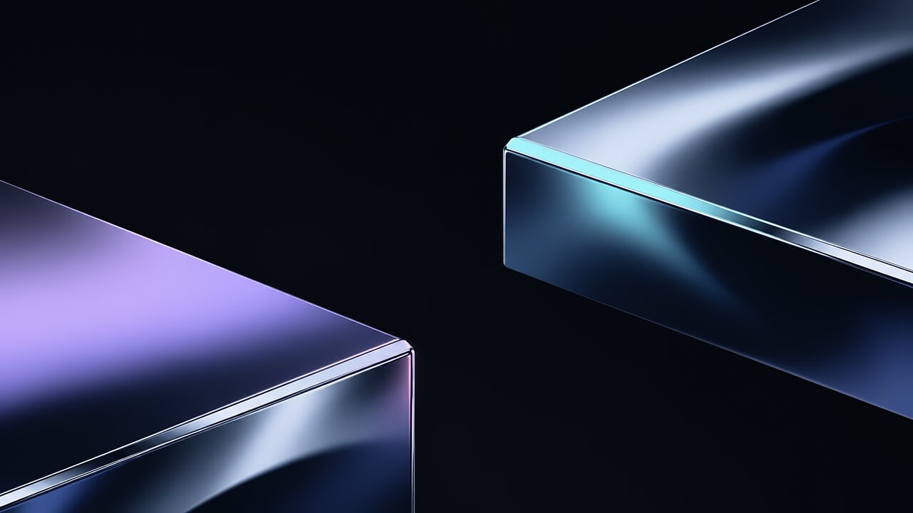 **Seb Chrome**: liquid mirror, polished metal in a dark studio with lilac and aqua light. | 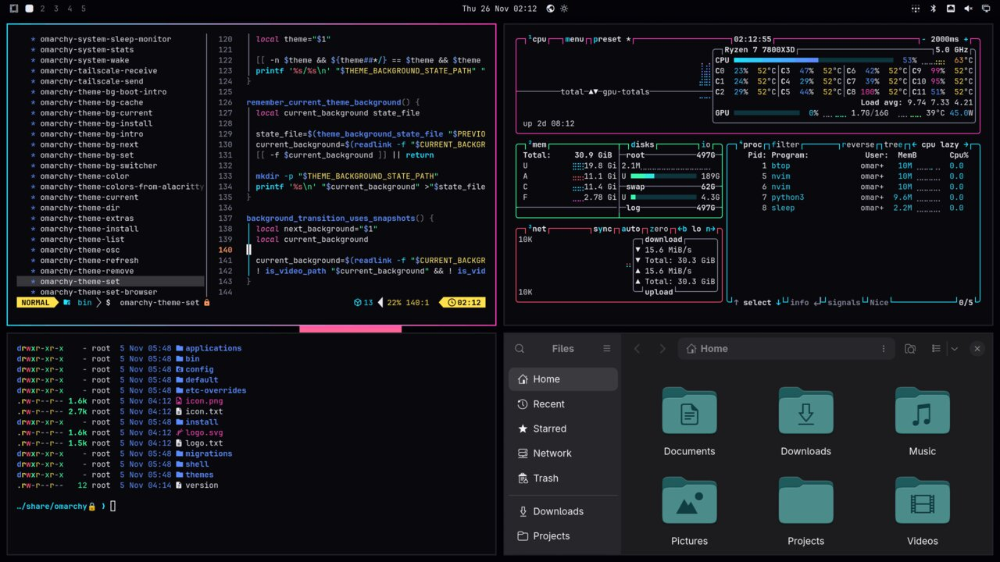 **Seb Datamosh**: a picture that broke into streaks and blocks of pure signal. |
| 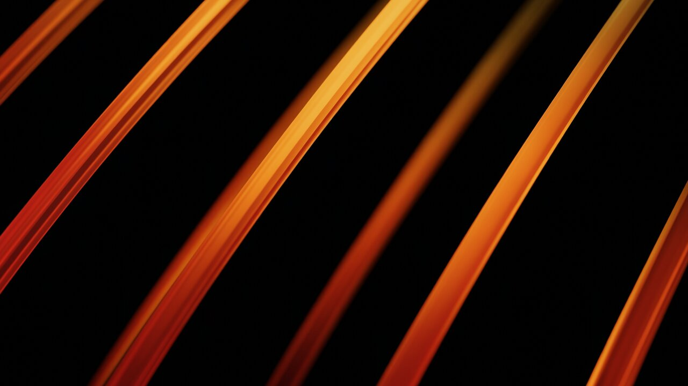 **Seb Ember**: true neutral black lit by warm whites, amber and ember orange. | 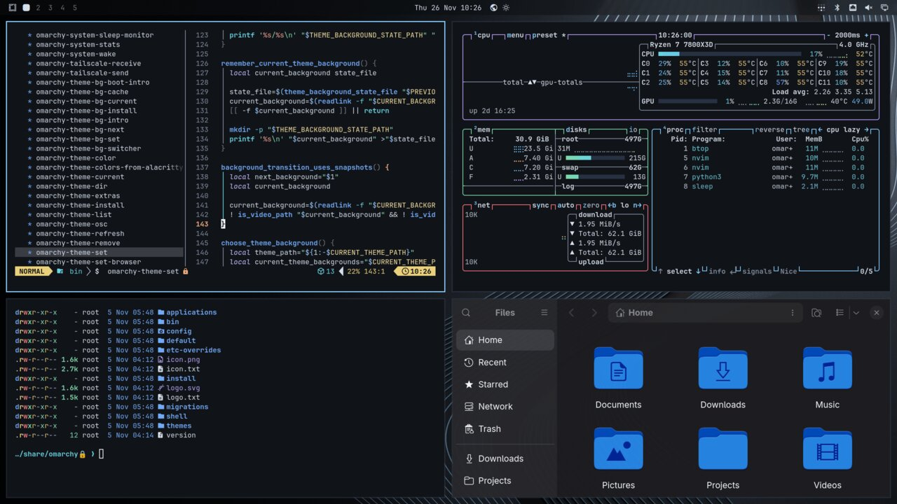 **Seb Glacier**: blue-black night, ice-blue accent, crisp cool whites. |
| 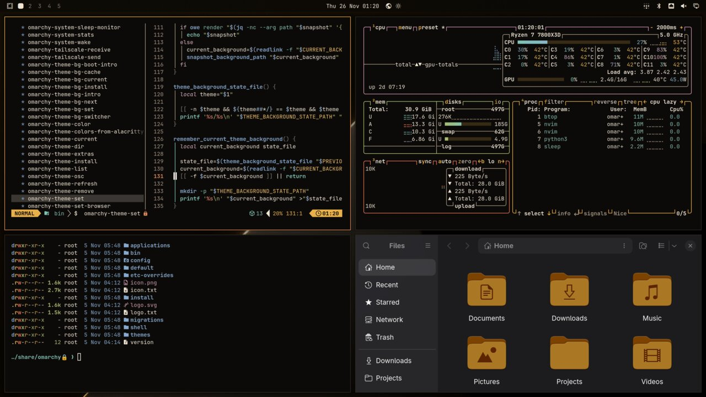 **Seb Lode**: matte black dunes with metal running through every crest. | 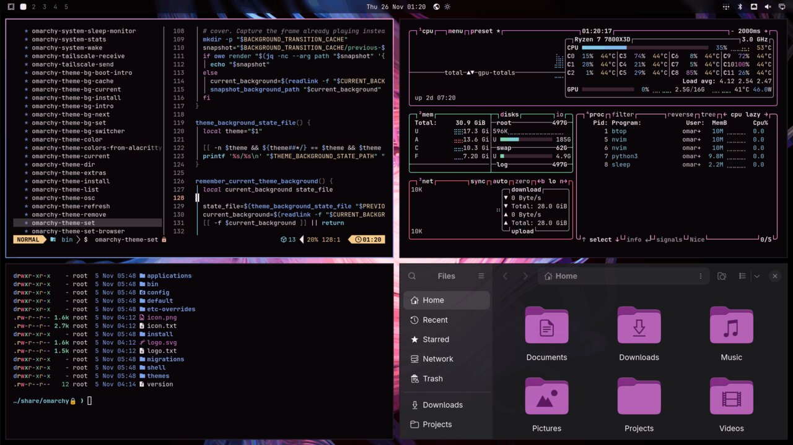 **Seb Organic**: glowing glass fibres, a pink-white core in orchid and periwinkle. |
| 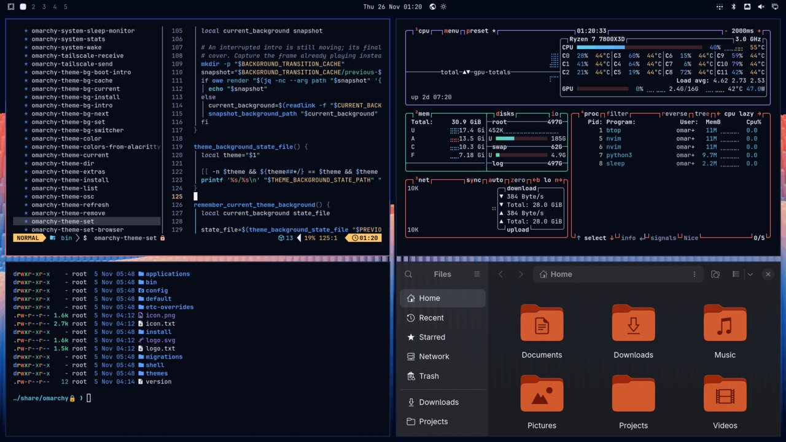 **Seb Rimlight**: large smooth forms asleep in the dark, one edge caught by hot light. | 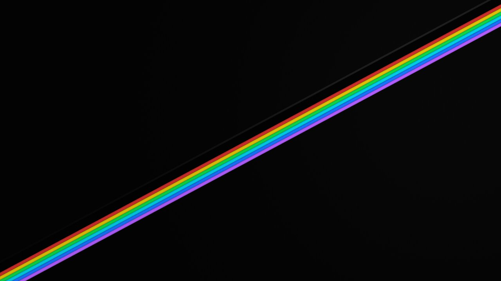 **Seb Spectra**: a black desktop where white light splits into its colours. |
| 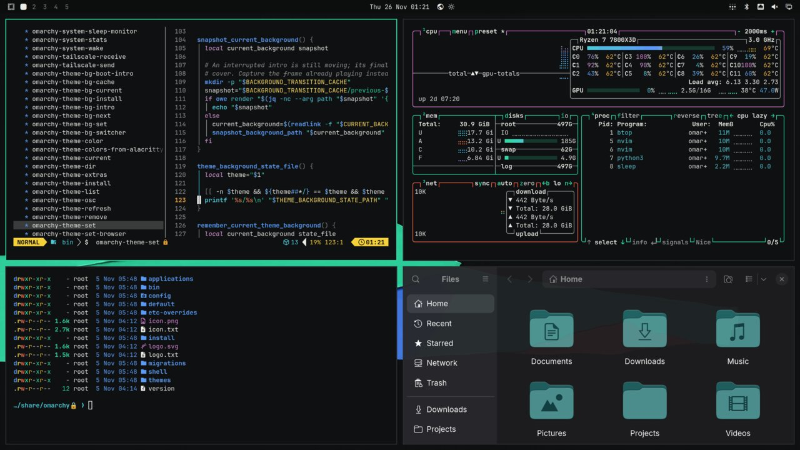 **Seb Squeegee**: one great abstract painting, pigment dragged in layers. | 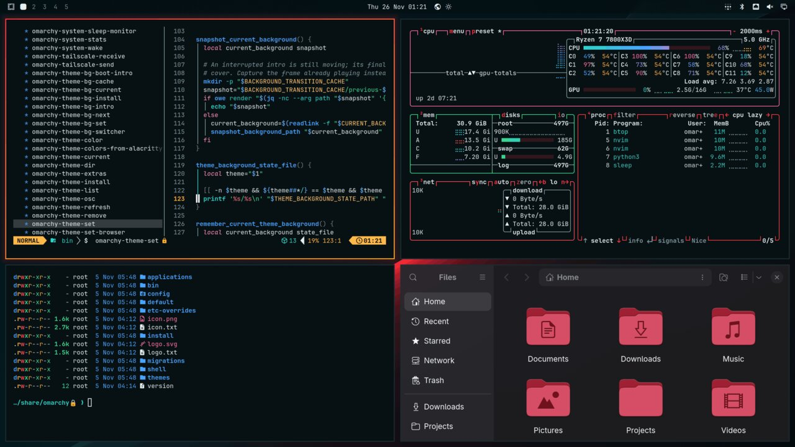 **Seb Taillight**: night speed, the city reduced to red taillight and sodium lamp. |
| 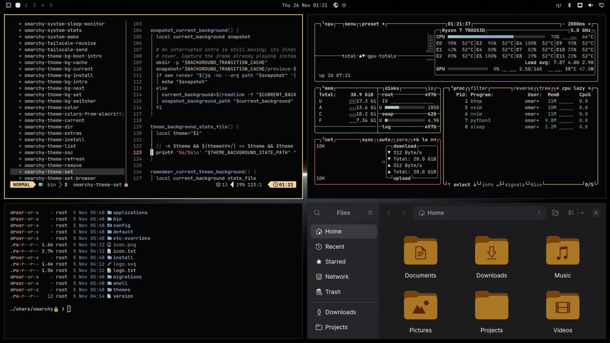 **Seb Totality**: the two minutes of a total eclipse, absolute black and one thin rim of pale light. | 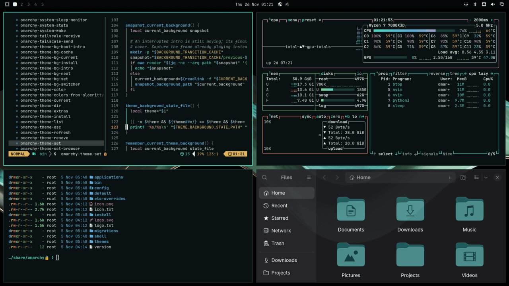 **Seb Verdigris**: century-old metal, green-black with turquoise patina. |
| 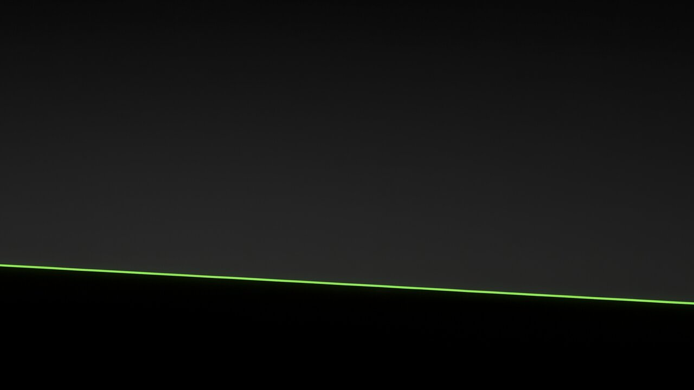 **Seb Volt**: graphite near-monochrome, and acid lime is the only thing that shouts. | |

Every theme sets the colours Omarchy carries to the terminal, editor, btop, the bar, menus and
the lock screen. Window rounding and shadows are left out: Omarchy runs no code from a theme
installed from git, so they would not reach you anyway.

## How this repo works

`main` holds every theme under `themes/`. On each push a workflow publishes each folder as a
branch of the same name with just that theme at its root, which is the shape Omarchy installs and
updates. To add a theme, add its folder. `gallery/` holds the pictures on this page.

## Licence and credits

MIT ([LICENSE](LICENSE)), all of it but one wallpaper:

The Seb Organic wallpaper is *Organic Glass (dark)* by UnionTech Software Technology (deepin),
[CC BY 4.0](https://creativecommons.org/licenses/by/4.0/), downscaled to 2560x1440; see
`themes/seb-organic/CREDITS.txt`. The other wallpapers were made for these themes.
